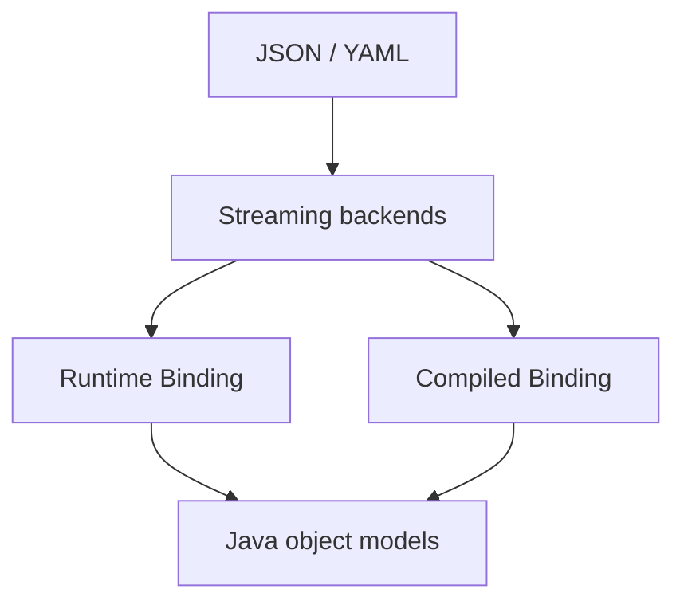

# Backends & Formats

SJF4J provides a unified API for JSON, YAML, and Java Properties while letting you choose the underlying parser and writer.

This is the detailed guide to **streaming backends and custom formats**. For Java object binding and value codecs, see [Binding](/docs/binding); for OBNT representation rules, see [Modeling (OBNT)](/docs/modeling).

## Supported Backends

| Format | Backend | SJF4J module |
| --- | --- | --- |
| JSON | Jackson 3.x | `sjf4j-backend-jackson3` |
| JSON | Jackson 2.x | `sjf4j-backend-jackson2` |
| JSON | Gson | `sjf4j-backend-gson` |
| JSON | Fastjson2 | `sjf4j-backend-fastjson2` |
| JSON | JSON-P | `sjf4j-backend-jsonp` |
| JSON | Simple (built-in) | `sjf4j-core` |
| YAML | SnakeYAML | `sjf4j-backend-snake` |
| Properties | Built-in | `sjf4j-core` |

Add the SJF4J adapter **and** its native library. For example, with Jackson 2.x:

```kotlin
implementation("org.sjf4j:sjf4j-core:{version}")
implementation("org.sjf4j:sjf4j-backend-jackson2:{version}")
implementation("com.fasterxml.jackson.core:jackson-databind:2.22.3")
```

See [Installation](/docs/installation) for Maven, other backend dependencies, and supported versions.

## Backend Selection

For the built-in JSON backends, the **default order (highest priority first)** is:

**Jackson 3 → Jackson 2 → Gson → Fastjson2 → JSON-P → Simple**

**Runtime:** `new Sjf4j()` discovers `BinderProvider` implementations via `ServiceLoader` and selects the highest-priority available provider. The built-in priorities are Jackson 3 (600), Jackson 2 (500), Gson (400), Fastjson2 (300), and JSON-P (200); Simple is the fallback. Availability requires the adapter and native library, plus an implementation for JSON-P. Custom providers can define their own priority. Use `Sjf4j.builder().jsonProvider(...)` to select one explicitly.

**Compiled:** `@CompiledBinder(backend = Backend.AUTO)` uses the same built-in order, but selects the first usable backend on the **compilation classpath**. It does not discover custom runtime providers. Specify a backend explicitly when needed:

```java
@CompiledBinder(backend = Backend.JACKSON2)
interface UserJson {
    @Read User read(String json);
}
```

The selected backend is fixed for the generated implementation. See [Binding](/docs/binding) and [Compiled APIs](/docs/compiled) for the full APIs.

## Custom Formats and Streaming

SJF4J separates **structural binding** from the underlying parser and writer. A backend implements the `StreamingParser` and `StreamingGenerator` contracts; SJF4J handles binding to POJOs, Maps, Lists, and other supported Java types.



### Example: Gson

Gson exposes a small streaming API through `JsonReader` and `JsonWriter`. SJF4J's adapter translates those operations into its own streaming contract. For example, these methods come directly from the Gson adapter (other required methods omitted):

```java
// GsonParser extends StreamingParser
@Override
public void readObjectStart() throws IOException {
    reader.beginObject();
}

@Override
public String readString() throws IOException {
    return nextIfNull() ? null : reader.nextString();
}

// GsonGenerator extends StreamingGenerator
@Override
public void writeObjectStart() throws IOException {
    writer.beginObject();
}

@Override
public void writeStringValue(String value) throws IOException {
    writer.value(value);
}
```

`GsonBinder` creates these adapters from Gson's native readers and writers. `GsonBinderProvider` exposes the binder through `ServiceLoader`, so applications can use the normal `Sjf4j` API without any Gson-specific binding code.

| Layer | Gson implementation | Responsibility |
| --- | --- | --- |
| Native streaming | `JsonReader` / `JsonWriter` | Read and write JSON tokens |
| SJF4J streaming | `GsonParser` / `GsonGenerator` | Translate streaming operations |
| Binding | `GsonBinder` | Create the parser and generator adapters |
| Discovery | `GsonBinderProvider` | Register the backend for selection |

### Adding a Backend

To integrate another streaming library or format:

1. **Adapt the stream.** Extend `StreamingParser` and `StreamingGenerator` to translate the native reader/writer into SJF4J's object, array, member-name, scalar, and null operations. Preserve the token-consumption contracts documented by those classes.
2. **Create a binder.** Extend `Binder<Parser, Generator>` and implement `createParser(Reader)` and `createGenerator(Writer)`. Add native byte-stream implementations if needed; the base class provides default stream and string helpers.
3. **Expose a provider.** Implement `BinderProvider` with a `Format`, selection `priority()`, and `create(RuntimeContext)`. Pass the supplied context into the binder.
4. **Register and test.** Add the provider to `META-INF/services/org.sjf4j.binding.BinderProvider`. Test round trips, nulls, nested values, error handling, and stream ownership.

For example, a JSON provider for a `MyJsonBinder` implementation:

```java
public final class MyJsonProvider implements BinderProvider {
    @Override public Format format() { return Format.JSON; }
    @Override public int priority() { return 350; }
    @Override public Binder<?, ?> create(RuntimeContext context) {
        return new MyJsonBinder(context);
    }
}
```

Its service file contains the provider's fully qualified class name:

```text
# src/main/resources/META-INF/services/org.sjf4j.binding.BinderProvider
com.example.MyJsonProvider
```

`priority()` matters only for automatic runtime provider selection through `BinderFactory`: higher priorities win, and ties for an available format are rejected. It is ignored when selecting a provider explicitly with `Sjf4j.builder().jsonProvider(...)` or using a compiled backend. Use `Format.JSON`, `Format.YAML`, or a custom identifier such as `Format.of("com.example:toml")`. Custom formats can be resolved through `BinderFactory`; the `Sjf4j` facade exposes built-in JSON, YAML, and Properties entry points.

### Compiled Backend Support

Custom `BinderProvider` implementations work with **Runtime** binding, but are not automatically supported by `@CompiledBinder`. Compiled backends are currently registered in SJF4J's annotation processor.

To contribute support for a new compiled backend, start with [`Backend`](https://github.com/sjf4j-projects/sjf4j/blob/main/sjf4j-core/src/main/java/org/sjf4j/annotation/binding/Backend.java) and [`BackendCatalog`](https://github.com/sjf4j-projects/sjf4j/blob/main/sjf4j-processor/src/main/java/org/sjf4j/processor/binding/BackendCatalog.java), then adapt code generation as needed in [`ReadEmitter`](https://github.com/sjf4j-projects/sjf4j/blob/main/sjf4j-processor/src/main/java/org/sjf4j/processor/binding/ReadEmitter.java) and [`WriteEmitter`](https://github.com/sjf4j-projects/sjf4j/blob/main/sjf4j-processor/src/main/java/org/sjf4j/processor/binding/WriteEmitter.java). Include generated-code and round-trip tests.

**Contributions are welcome.** Open a [GitHub issue](https://github.com/sjf4j-projects/sjf4j/issues) to discuss an integration or submit a pull request.

For working directly with a library's *existing in-memory node tree*, use [External Nodes](/docs/external-nodes) instead. For a complete reference implementation, see [GsonBinder](https://github.com/sjf4j-projects/sjf4j/blob/main/sjf4j-backend-gson/src/main/java/org/sjf4j/backend/gson/binding/GsonBinder.java) and [GsonParser](https://github.com/sjf4j-projects/sjf4j/blob/main/sjf4j-backend-gson/src/main/java/org/sjf4j/backend/gson/binding/GsonParser.java).

**API Reference (latest release):** [BinderFactory](https://javadoc.io/doc/org.sjf4j/sjf4j-core/latest/org/sjf4j/binding/BinderFactory.html) · [BinderProvider](https://javadoc.io/doc/org.sjf4j/sjf4j-core/latest/org/sjf4j/binding/BinderProvider.html) · [StreamingParser](https://javadoc.io/doc/org.sjf4j/sjf4j-core/latest/org/sjf4j/binding/StreamingParser.html) · [StreamingGenerator](https://javadoc.io/doc/org.sjf4j/sjf4j-core/latest/org/sjf4j/binding/StreamingGenerator.html)
