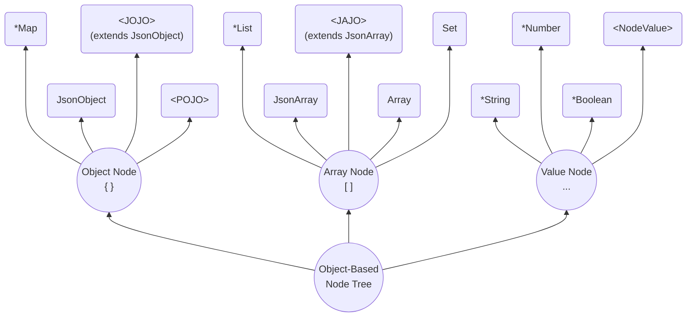

# OBNT (Object-Based Node Tree)

SJF4J brings **JSON semantics to ordinary Java objects**. Its OBNT (Object-Based Node Tree) provides a shared structural model for POJOs, Maps, Lists, JSON containers, and custom types—without requiring a separate JSON tree.

You can keep the Java model that fits your application and still use the same structural operations. This page explains the model itself; serialization, JSONPath, validation, and mapping are covered in their respective guides.

## Understanding OBNT



*The starred types are the default raw representations for JSON values when no target Java type is supplied.*

### Three kinds of nodes

Every supported OBNT value has a logical JSON shape:

| Node | Meaning | Java representations |
| --- | --- | --- |
| **Object Node** | Named members | `Map`, `JsonObject`, POJO, JOJO |
| **Array Node** | An ordered sequence of elements | `List`, Java array, `JsonArray`, JAJO; also `Set` with ordering caveats |
| **Value Node** | A scalar, null, or a custom logical value | `String`, numbers, booleans, enums, `null`, `@NodeValue` types |

The key idea is that a Java class does not have to inherit from an SJF4J base type to participate in this model. A regular POJO can be an object node; a `List` can be an array node; and an application-specific identifier can be a single value node.

OBNT can be extended with [`ExternalNode` adapters](/docs/external-nodes), allowing third-party Java types to represent **object, array, or value nodes** (including JSON null). One adapter may support multiple shapes, as with Gson's `JsonElement` hierarchy.

### JSON semantics vs. Java representations

OBNT separates **what a value represents** from **how Java stores it**:

- `JsonType` describes the logical JSON shape (`OBJECT`, `ARRAY`, `STRING`, `NUMBER`, `BOOLEAN`, `NULL`, or `UNKNOWN`). `INTEGER` is also used for JSON Schema semantics.
- `NodeKind` identifies the Java representation used for dispatch, such as `OBJECT_MAP`, `OBJECT_POJO`, or `ARRAY_LIST`.

For example:

```java
Map<String, Object> user = new HashMap<>();

JsonType.of(user); // JsonType.OBJECT
NodeKind.of(user); // NodeKind.OBJECT_MAP
```

A `Map`, a POJO, and a JOJO can all have `JsonType.OBJECT` while retaining different `NodeKind` values. Most application code should care about the **JSON structure**, not the representation-specific classification.

### No intermediate tree required

A typical raw object graph uses `Map<String, Object>` for objects, `List<Object>` for arrays, and ordinary Java scalar values for leaves. Typed object graphs can use POJOs and other supported representations instead.

SJF4J operates on these Java values directly. It does not need to wrap every node in a new AST type before navigating, patching, or validating it. The underlying Java objects remain available to the rest of your application.

## Representing Data

### Object nodes

Four common choices represent JSON objects:

| Representation | Choose it when |
| --- | --- |
| `Map<String, Object>` | Keys and values are dynamic; standard Java collections are sufficient |
| `JsonObject` | You want a dynamic object with convenient JSON-oriented accessors |
| **POJO** | Your model has a stable, strongly typed Java contract |
| **JOJO** | You need typed Java properties **and** undeclared JSON members |

A **JOJO (JSON Object Java Object)** extends `JsonObject`. Declared members remain normal Java properties, while unknown members can be retained as dynamic members.

```java
public class User extends JsonObject {
    public String name;
    public List<User> friends;
}

String json = "{\"name\":\"Alice\",\"friends\":["
        + "{\"name\":\"Bill\",\"active\":true},"
        + "{\"name\":\"Cindy\"}],\"age\":18}";
User user = new Sjf4j().fromJson(json, User.class);

String name = user.name;                // Declared property
Integer age = user.getInteger("age");   // Dynamic member
```

`Nodes.inspect(...)` reveals the difference, including in nested JOJOs (output abbreviated):

```java
System.out.println(Nodes.inspect(user));
// @User{*name=Alice, *friends=[@User{*name=Bill, *friends=null, active=true}, ...], age=18}
//        └─────────────┴─────┬─────────┴────────────┘             └───────────┬──────┘
//                            ↓                                                ↓
//              Declared properties in POJO/JOJO                    Dynamic members in JOJO
```

The `*` marks a declared Java property. Unmarked members such as `age` and `active` are dynamic members retained from JSON. You can also add them at runtime with `user.put("verified", true)`.

This is an **open object model**: stable data has Java types, while extensions remain accessible without changing the class. A POJO is still the simpler default for a closed domain model.

### Array nodes

Array representations follow the same idea:

| Representation | Choose it when |
| --- | --- |
| `List` | You want a standard, resizable Java sequence |
| Java array | The element type and length are fixed |
| `Set` | Uniqueness matters; do not rely on JSON array ordering |
| `JsonArray` | You want index-based JSON-oriented access and mutation |
| **JAJO** | You want a specialized `JsonArray` subtype |

A **JAJO (JSON Array Java Object)** extends `JsonArray`. Unlike a JOJO, it does not add dynamic named object members; it models an array. A subtype can restrict non-null elements by overriding `elementClass()`:

```java
public class Labels extends JsonArray {
    @Override
    public Class<?> elementClass() {
        return String.class;
    }
}

Labels labels = new Labels();
labels.add("java");
labels.add("json");
String last = labels.getString(-1); // "json"
```

`JsonArray` supports negative indexes, with `-1` referring to the last element. Java arrays and Sets have different mutation and ordering constraints; OBNT does not erase those Java collection rules.

### Value nodes

Standard strings, numbers, booleans, and null values are leaves in OBNT. Enums and supported domain-specific scalar types can also participate as values.

Use `@NodeValue` when a Java type should be treated as **one logical value**, not traversed as an object with properties. For example, a `UserId` may be represented as a single JSON string. A value codec can also encode a logical value using a Map or List; that raw encoding **does not turn the logical value into a traversable OBNT object or array**.

The conversion contract for custom values is described under [Custom Value Types](#custom-value-types).

### Choosing a representation

Prefer the simplest model that expresses your contract:

- **Domain entities and DTOs:** start with POJOs.
- **Typed payloads with extensible fields:** use JOJOs.
- **Mostly dynamic data:** use `Map` or `JsonObject`.
- **Sequences:** use `List` or a Java array; choose `JsonArray` for JSON-oriented instance methods or a JAJO for a specialized array type.
- **Domain-specific scalar wrappers:** use `@NodeValue` when they should behave as values.

The decision is about **your Java model**, not which parsing library you use. You can keep POJOs even when your input comes from different JSON or YAML backends.

## Working with Nodes

### One structural API for Java values

`Nodes` is the static utility API for OBNT structures. It gives you consistent operations without requiring a `JsonObject` or `JsonArray` instance:

```java
Map<String, Object> user = new HashMap<>();
Nodes.putInObject(user, "name", "Alice");

String name = Nodes.toString(Nodes.getInObject(user, "name"));

List<Object> roles = new ArrayList<>();
Nodes.addInArray(roles, "reader");
Object first = Nodes.getInArray(roles, 0);
```

Supported POJOs and other object nodes can be accessed through the same object-oriented operations. Mutations depend on what the underlying Java representation permits; a read-only or fixed-size structure is not made mutable by OBNT.

### Convenient instance APIs

`JsonObject` and `JsonArray` provide equivalent capabilities in a more direct style:

```java
JsonObject user = JsonObject.of("name", "Alice", "active", true);

String name = user.getString("name");
user.put("city", "Berlin");

JsonArray roles = JsonArray.of("reader", "writer");
roles.add("admin");
String last = roles.getString(-1); // "admin"
```

Use `Nodes` for representation-independent code and the instance APIs when you explicitly choose these containers.

### Strict access vs. conversion

Scalar access has two deliberately different behaviors:

- `toXxx()` requires a compatible scalar type and performs strict conversion within that type family.
- `asXxx()` allows supported cross-type coercions, such as a numeric string to an integer.

```java
Object value = "123";

String text = Nodes.toString(value); // "123"
Integer number = Nodes.asInt(value); // 123
Nodes.toInt(value);                   // Error: not a numeric node
```

Both return `null` for Java `null` input. Incompatible non-null values can still raise an error; lenient conversion is not silent error suppression. The `JsonObject` and `JsonArray` getters follow the same distinction (for example, `getInt` vs. `getAsInt`).

### Traversal, equality, and copying

Use the structural operations when Java representation details should not determine the result:

```java
Nodes.forEachObject(user, (key, value) ->
        System.out.println(key + ": " + value));

boolean same = Nodes.equals(
        JsonObject.of("count", 1),
        Collections.singletonMap("count", 1L)); // true

JsonObject copy = user.copy();     // Shallow: nested values are shared
JsonObject deep = user.deepCopy(); // Recursively copies supported nodes
```

`Nodes.equals(...)` compares JSON structure and values rather than requiring identical Java container classes; numbers are compared by numeric value. The related `Nodes.hash(...)` follows these structural semantics.

`Nodes.copy(...)` and container `copy()` methods are **shallow**: they duplicate the outer structure but share nested references. Deep copying is a separate operation, available on `JsonObject` / `JsonArray` and through SJF4J's deep-node conversion facilities. The exact behavior of external node types depends on their adapters.

For advanced OBNT operations, explore [`NodeWalker`](https://github.com/sjf4j-projects/sjf4j/blob/main/sjf4j-core/src/main/java/org/sjf4j/node/NodeWalker.java) for structural access and recursive traversal, [`NodeMapper`](https://github.com/sjf4j-projects/sjf4j/blob/main/sjf4j-core/src/main/java/org/sjf4j/node/NodeMapper.java) for runtime conversion between Java node representations, and [`NodeStream`](https://github.com/sjf4j-projects/sjf4j/blob/main/sjf4j-core/src/main/java/org/sjf4j/node/NodeStream.java) for stream-style processing with JSONPath helpers.

For complete method signatures, see the [Javadocs](https://javadoc.io/doc/org.sjf4j/sjf4j-core).

## Customizing the Model

The default model works with ordinary Java objects. The following extensions let you control how a type participates in OBNT without changing the underlying JSON semantics.

### Property modeling

Use `@NodeObject` for class-level rules such as property discovery and naming; use `@NodeProperty` for individual property names, accepted aliases, or value formats.

```java
@NodeObject(naming = NamingStrategy.SNAKE_CASE)
public class Account {
    @NodeProperty("id")
    public String accountId;

    public String displayName;
}
```

Here `accountId` binds to `id`, while `displayName` follows the snake-case rule (`display_name`). The class-level `propertyStrategy` can select field- or bean-oriented discovery. On JOJOs, `readDynamic` and `writeDynamic` control whether unknown members are retained on reads and emitted on writes.

These annotations configure the object model; they do not require every Java class to be annotated.

### Polymorphic types

`@OneOf` describes which concrete subtype to use when a declared type can represent multiple alternatives.

```java
interface Animal {}

class Dog implements Animal {
    public String name;
}

class Cat implements Animal {
    public String name;
}

class Zoo {
    @OneOf(discriminatorKey = "kind", cases = {
        @OneOfCase(type = Dog.class, when = "dog"),
        @OneOfCase(type = Cat.class, when = "cat")
    })
    public Animal pet;
}
```

For a `pet` object containing `"kind": "dog"`, binding can select `Dog`. SJF4J also supports shape-based selection for distinct raw JSON types and selected parent-level discriminator patterns. These modes have constraints, especially in compiled binding; see [Binding](/docs/binding) for details.

### Custom value types

A value type can declare its own raw representation:

```java
@NodeValue
public final class UserId {
    private final String value;

    public UserId(String value) {
        this.value = value;
    }

    @ValueToRaw
    public String toRaw() {
        return value;
    }

    @RawToValue
    public static UserId fromRaw(String raw) {
        return raw == null ? null : new UserId(raw);
    }
}
```

This makes `UserId` a logical value node, serialized here as a JSON string rather than as an object with a `value` property.

For reusable or multi-format conversions, SJF4J also supports `ValueCodec` registrations, including named formats selected by `@NodeProperty(valueFormat = ...)` or runtime configuration. The distinction is important: a codec's raw Map/List representation is an **encoding choice**, not a change to the logical node category.

### External node integration

`ExternalNode<N>` integrates backend-native JSON trees and other structural representations into OBNT. The same adapter can expose different instances as object, array, or value nodes.

An adapter identifies its node type and JSON shape, then implements the access, iteration, mutation, conversion, and copying operations it supports. This keeps existing native trees available instead of forcing an eager conversion into `Map` / `List`. Not every operation is automatically supported: unimplemented adapter operations can fail explicitly.

SJF4J already provides integrations for supported native node models. Build a custom adapter only when you need another representation or operation set. See [External Nodes](/docs/external-nodes) for supported models and a Gson-based integration example.

## Beyond Modeling

OBNT supplies the shared **structure**; the other SJF4J capabilities supply the **operations**:

| Capability | What it adds |
| --- | --- |
| [Binding](/docs/binding) | Read and write supported Java models across data formats and backends |
| [Navigating](/docs/navigating) | Query and update object graphs using JSONPath and JSON Pointer |
| [Patching](/docs/patching) | Apply JSON Patch and Merge Patch to supported objects |
| [Validating](/docs/validating) | Validate Java values directly against JSON Schema |
| [Object Mapping](/docs/mapping) | Convert between object models and generate specialized mappers |

Compiled APIs can optimize supported binding, navigation, validation, and mapping operations, but **OBNT itself does not require annotation processing**. You can start with ordinary Java objects and runtime APIs, then adopt compiled implementations where useful.

Learn more: [Enjoy Compiled APIs](/docs/compiled)
