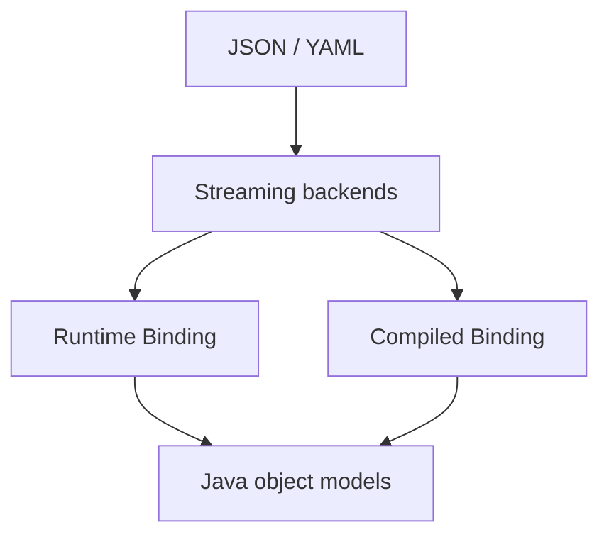

# 后端与数据格式 {#backends-formats}

SJF4J 为 JSON、YAML 和 Java Properties 提供统一 API，同时允许你选择底层解析器和生成器。

本页详细介绍**流式后端与自定义格式**。Java 对象绑定参阅 [Binding](/docs/binding)；自定义值格式及注册参阅 [Value Codecs](/docs/value-codecs)；OBNT 结构表示参阅 [Modeling (OBNT)](/docs/modeling)。

## 支持的后端 {#supported-backends}

| 格式 | 后端 | SJF4J 模块 |
| --- | --- | --- |
| JSON | Jackson 3.x | `sjf4j-backend-jackson3` |
| JSON | Jackson 2.x | `sjf4j-backend-jackson2` |
| JSON | Gson | `sjf4j-backend-gson` |
| JSON | Fastjson2 | `sjf4j-backend-fastjson2` |
| JSON | JSON-P | `sjf4j-backend-jsonp` |
| JSON | Simple（内置） | `sjf4j-core` |
| YAML | SnakeYAML | `sjf4j-backend-snake` |
| Properties | 内置 | `sjf4j-core` |

只需引入对应的 SJF4J 后端模块，所需原生库会通过传递依赖引入。例如使用 Jackson 2.x：

```kotlin
implementation("org.sjf4j:sjf4j-core:{version}")
implementation("org.sjf4j:sjf4j-backend-jackson2:{version}")
```

Maven 配置、后端库版本及其他模块详见 [Installation](/docs/installation)。

## 后端选择 {#backend-selection}

内置 JSON 后端的**默认优先级（从高到低）**为：

**Jackson 3 → Jackson 2 → Gson → Fastjson2 → JSON-P → Simple**

**Runtime：** `new Sjf4j()` 通过 `ServiceLoader` 发现 `BinderProvider` 实现，并选择优先级最高的可用提供者。内置优先级分别为 Jackson 3（600）、Jackson 2（500）、Gson（400）、Fastjson2（300）和 JSON-P（200）；Simple 作为回退。适配器和原生库必须可用，JSON-P 还需要实现库。自定义提供者可以设定自己的优先级。也可以使用 `Sjf4j.builder().jsonProvider(...)` 显式选择。

**Compiled：** `@CompiledBinder(backend = Backend.AUTO)` 使用相同的内置顺序，但会在**编译类路径**上选择第一个可用后端，不会发现自定义 Runtime Provider。需要时可以显式指定后端：

```java
@CompiledBinder(backend = Backend.JACKSON2)
interface UserJson {
    @Read User read(String json);
}
```

生成实现所使用的后端是固定的。完整 API 参阅 [Binding](/docs/binding) 和 [Compiled APIs](/docs/compiled)。

## 自定义格式与流式处理 {#custom-formats-and-streaming}

SJF4J 将**结构化数据绑定**与底层解析器、写入器分离。后端实现 `StreamingParser` 和 `StreamingGenerator` 契约；SJF4J 则负责将数据绑定到 POJO、Map、List 等受支持的 Java 类型。



### Gson 示例 {#example-gson}

Gson 通过 `JsonReader` 和 `JsonWriter` 提供流式 API。SJF4J 的适配器将这些操作转换为自己的流式契约。下列方法直接来自 Gson 适配器（省略其他必要方法）：

```java
// GsonParser extends StreamingParser
@Override
public void readObjectStart() throws IOException {
    reader.beginObject();
}

@Override
public String readString() throws IOException {
    return nextIfNull() ? null : reader.nextString();
}

// GsonGenerator extends StreamingGenerator
@Override
public void writeObjectStart() throws IOException {
    writer.beginObject();
}

@Override
public void writeStringValue(String value) throws IOException {
    writer.value(value);
}
```

`GsonBinder` 使用 Gson 原生 Reader 和 Writer 创建这些适配器。`GsonBinderProvider` 通过 `ServiceLoader` 暴露 Binder，因此应用可以继续使用通用 `Sjf4j` API，无须编写 Gson 专用的数据绑定代码。

| 层次 | Gson 实现 | 职责 |
| --- | --- | --- |
| 原生流式接口 | `JsonReader` / `JsonWriter` | 读写 JSON token |
| SJF4J 流式接口 | `GsonParser` / `GsonGenerator` | 转换流式操作 |
| 绑定层 | `GsonBinder` | 创建 Parser 和 Generator 适配器 |
| 发现机制 | `GsonBinderProvider` | 注册后端，供选择时使用 |

### 添加后端 {#adding-a-backend}

接入新的流式库或数据格式时：

1. **适配数据流。** 继承 `StreamingParser` 与 `StreamingGenerator`，将原生 Reader/Writer 映射到 SJF4J 的对象、数组、成员名、标量与 null 操作。遵守这些类定义的 token 消费契约。
2. **创建 Binder。** 继承 `Binder<Parser, Generator>`，实现 `createParser(Reader)` 与 `createGenerator(Writer)`。按需添加原生字节流实现；基类提供默认的流和字符串辅助方法。
3. **提供 Provider。** 实现 `BinderProvider`，声明 `Format`、选择优先级 `priority()` 和 `create(NodeConfig)`，并将传入的配置交给 Binder。
4. **注册并测试。** 在 `META-INF/services/org.sjf4j.binding.BinderProvider` 中注册 Provider，测试往返转换、null、嵌套值、异常处理及数据流所有权。

例如，为 `MyJsonBinder` 定义一个 JSON Provider：

```java
public final class MyJsonProvider implements BinderProvider {
    @Override public Format format() { return Format.JSON; }
    @Override public int priority() { return 350; }
    @Override public Binder<?, ?> create(NodeConfig config) {
        return new MyJsonBinder(config);
    }
}
```

服务描述文件中填写 Provider 的完整类名：

```text
# src/main/resources/META-INF/services/org.sjf4j.binding.BinderProvider
com.example.MyJsonProvider
```

`priority()` 仅影响通过 `BinderFactory` 进行的 Runtime 自动选择：优先级高者胜出，同一格式出现可用 Provider 的优先级冲突时会报错。使用 `Sjf4j.builder().jsonProvider(...)` 显式指定 Provider，或使用 Compiled 后端时，该优先级不生效。

可以使用 `Format.JSON`、`Format.YAML` 或 `Format.of("com.example:toml")` 这样的自定义标识。自定义格式可通过 `BinderFactory` 解析；`Sjf4j` 门面提供内置 JSON、YAML 和 Properties 的入口。

### Compiled 后端支持 {#compiled-backend-support}

自定义 `BinderProvider` 可以用于 **Runtime Binding**，但不会自动得到 `@CompiledBinder` 支持。目前编译式后端在 SJF4J 注解处理器中注册。

要为新后端添加编译式支持，可以从 [`Backend`](https://github.com/sjf4j-projects/sjf4j/blob/main/sjf4j-core/src/main/java/org/sjf4j/annotation/binding/Backend.java) 和 [`BackendCatalog`](https://github.com/sjf4j-projects/sjf4j/blob/main/sjf4j-processor/src/main/java/org/sjf4j/processor/binding/BackendCatalog.java) 开始，再根据需要修改 [`ReadEmitter`](https://github.com/sjf4j-projects/sjf4j/blob/main/sjf4j-processor/src/main/java/org/sjf4j/processor/binding/ReadEmitter.java) 与 [`WriteEmitter`](https://github.com/sjf4j-projects/sjf4j/blob/main/sjf4j-processor/src/main/java/org/sjf4j/processor/binding/WriteEmitter.java) 的代码生成，并补充生成代码及往返测试。

**欢迎贡献。** 可以提交 [GitHub Issue](https://github.com/sjf4j-projects/sjf4j/issues) 讨论集成方案，或直接提交 Pull Request。

如果需要直接操作第三方库**已有的内存节点树**，应使用 [External Nodes](/docs/external-nodes)，而不是扩展流式后端。完整实现可以参考 [GsonBinder](https://github.com/sjf4j-projects/sjf4j/blob/main/sjf4j-backend-gson/src/main/java/org/sjf4j/backend/gson/binding/GsonBinder.java) 和 [GsonParser](https://github.com/sjf4j-projects/sjf4j/blob/main/sjf4j-backend-gson/src/main/java/org/sjf4j/backend/gson/binding/GsonParser.java)。

**API 参考（最新发布版本）：** [BinderFactory](https://javadoc.io/doc/org.sjf4j/sjf4j-core/latest/org/sjf4j/binding/BinderFactory.html) · [BinderProvider](https://javadoc.io/doc/org.sjf4j/sjf4j-core/latest/org/sjf4j/binding/BinderProvider.html) · [StreamingParser](https://javadoc.io/doc/org.sjf4j/sjf4j-core/latest/org/sjf4j/binding/StreamingParser.html) · [StreamingGenerator](https://javadoc.io/doc/org.sjf4j/sjf4j-core/latest/org/sjf4j/binding/StreamingGenerator.html)
