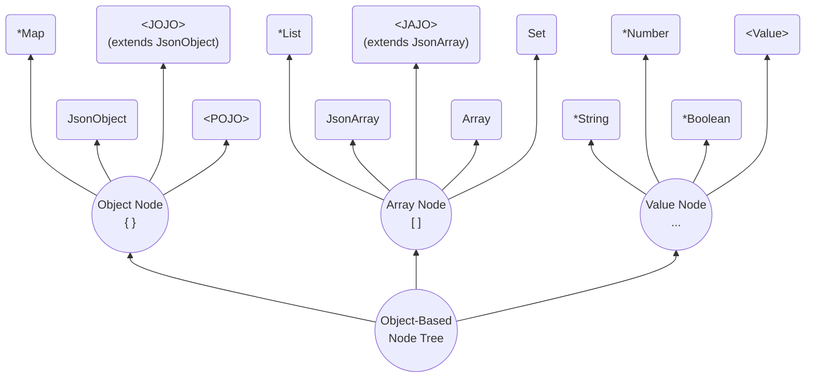

# OBNT (Object-Based Node Tree)

SJF4J 将 **JSON 语义直接应用于普通 Java 对象**。OBNT (Object-Based Node Tree) 为 POJO、Map、List、JSON 容器及自定义类型提供统一的结构模型，**无需构建额外的 JSON 树**。

你可以继续使用符合业务需要的 Java 模型，同时调用相同的结构化 API。本页介绍 OBNT 模型；序列化、JSONPath、校验和对象映射分别在对应文档中说明。

## 理解 OBNT {#understanding-obnt}



*带星号（`*`）的类型，是在未指定目标 Java 类型时，JSON 值默认采用的原始表示。*

### 三种节点 {#three-kinds-of-nodes}

OBNT 将支持的 Java 值按 JSON 逻辑结构分为三类：

| 节点 | 含义 | Java 表示 |
| --- | --- | --- |
| **Object Node** | 具有名称的成员 | `Map`、`JsonObject`、POJO、JOJO |
| **Array Node** | 有序的元素序列 | `List`、Java 数组、`JsonArray`、JAJO；`Set` 也支持，但有顺序限制 |
| **Value Node** | 标量、`null` 或自定义逻辑值 | `String`、数字、布尔值、枚举、`null`、`@NodeValue` 类型 |

关键在于：**Java 类不必继承 SJF4J 的基类**。普通 POJO 可以是Object Node，`List` 可以是Array Node，业务标识符也可以作为单一Value Node。

通过 [`ExternalNode` 适配器](/docs/external-nodes)，第三方 Java 类型也可表示**Object Node、Array Node 或 Value Node**（包括 JSON null）。同一个适配器能够支持多种形态，例如 Gson 的 `JsonElement` 类型体系。

### JSON 语义与 Java 表示 {#json-semantics-vs-java-representations}

OBNT 区分**值在 JSON 中表示什么**，以及**它在 Java 中如何存储**：

- `JsonType` 表示逻辑 JSON 类型：`OBJECT`、`ARRAY`、`STRING`、`NUMBER`、`BOOLEAN`、`NULL` 或 `UNKNOWN`；JSON Schema 语义中还使用 `INTEGER`。
- `NodeKind` 标识实际 Java 表示，供内部操作分派使用，例如 `OBJECT_MAP`、`OBJECT_POJO` 和 `ARRAY_LIST`。

例如：

```java
Map<String, Object> user = new HashMap<>();

JsonType.of(user); // JsonType.OBJECT
NodeKind.of(user); // NodeKind.OBJECT_MAP
```

`Map`、POJO、JOJO 都可以是 `JsonType.OBJECT`，但各自具有不同的 `NodeKind`。对大多数业务代码而言，应关注 **JSON 结构**，而非内部表示类别。

### 无需中间树 {#no-intermediate-tree-required}

典型的动态对象图使用 `Map<String, Object>` 表示对象，`List<Object>` 表示数组，普通 Java 标量表示叶子节点。强类型模型则可以使用 POJO 等其他受支持的表示。

SJF4J 直接操作这些 Java 对象。导航、补丁或校验之前，不需要把每个节点包装成新的 AST。底层对象仍可被应用程序原样使用。

## 数据表示方式 {#representing-data}

### Object Node {#object-nodes}

JSON 对象通常有四种表示：

| 表示 | 适用场景 |
| --- | --- |
| `Map<String, Object>` | 键和值动态变化，使用标准 Java 集合即可 |
| `JsonObject` | 需要带有便捷 JSON 风格访问方法的动态对象 |
| **POJO** | 需要稳定、强类型的 Java 数据契约 |
| **JOJO** | 既需要强类型 Java 属性，又需要保留未声明的 JSON 成员 |

**JOJO (JSON Object Java Object)** 继承 `JsonObject`。声明过的成员仍是普通 Java 属性，未声明的成员则可以作为动态成员保留下来。

```java
public class User extends JsonObject {
    public String name;
    public List<User> friends;
}

String json = "{\"name\":\"Alice\",\"friends\":["
        + "{\"name\":\"Bill\",\"active\":true},"
        + "{\"name\":\"Cindy\"}],\"age\":18}";
User user = new Sjf4j().fromJson(json, User.class);

String name = user.name;                // Declared property
Integer age = user.getInteger("age");   // Dynamic member
```

`Nodes.inspect(...)` 可查看两类属性的区别，包括嵌套 JOJO（以下输出已简化）：

```java
System.out.println(Nodes.inspect(user));
// @User{*name=Alice, *friends=[@User{*name=Bill, *friends=null, active=true}, ...], age=18}
//        └─────────────┴─────┬─────────┴────────────┘             └───────────┬──────┘
//                            ↓                                                ↓
//              Declared properties in POJO/JOJO                    Dynamic members in JOJO
```

输出中的 `*` 标记已声明的 Java 属性；`age`、`active` 等不带星号的成员是从 JSON 保留下来的动态属性。你还可以通过 `user.put("verified", true)` 在运行时添加成员。

这是一种**开放对象模型**：稳定字段保留 Java 类型，扩展字段不必修改类定义就能访问。如果领域模型不需要动态字段，POJO 仍是更简单的默认选择。

### Array Node {#array-nodes}

Array Node也有多种表示：

| 表示 | 适用场景 |
| --- | --- |
| `List` | 标准、可扩容的 Java 元素序列 |
| Java 数组 | 元素类型和长度固定 |
| `Set` | 需要唯一性，但不能依赖 JSON 数组顺序 |
| `JsonArray` | 需要按下标访问和修改的 JSON 风格 API |
| **JAJO** | 需要扩展 `JsonArray` 的专用子类 |

**JAJO (JSON Array Java Object)** 继承 `JsonArray`。与 JOJO 不同，它表示的是数组，不添加按名称访问的动态对象成员。子类可以重写 `elementClass()` 来约束非 null 元素类型：

```java
public class Labels extends JsonArray {
    @Override
    public Class<?> elementClass() {
        return String.class;
    }
}

Labels labels = new Labels();
labels.add("java");
labels.add("json");
String last = labels.getString(-1); // "json"
```

`JsonArray` 支持负数下标，`-1` 代表最后一个元素。Java 数组和 `Set` 本身的修改及顺序约束仍然适用；OBNT 不会改变 Java 集合的规则。

### Value Node {#value-nodes}

普通字符串、数字、布尔值及 null 都是 OBNT 的叶子节点。枚举及受支持的业务标量类型也可以作为值。

当 Java 类型应当被视为**一个逻辑值**，而不是可遍历的属性对象时，可以使用 `@NodeValue`。例如，`UserId` 可表示为单个 JSON 字符串。ValueCodec也可能用 Map/List 作为原始编码，但这种编码**不会让逻辑值变成可遍历的 OBNT 对象或数组**。

自定义值的转换契约参阅[自定义值类型](#custom-value-types)。

### 如何选择表示方式 {#choosing-a-representation}

优先使用能表达业务契约的最简单模型：

- **领域实体和 DTO：** 首选 POJO。
- **带可扩展字段的强类型数据：** 使用 JOJO。
- **大部分字段都是动态的：** 使用 `Map` 或 `JsonObject`。
- **元素序列：** 使用 `List` 或 Java 数组；需要实例级 JSON API 时使用 `JsonArray`，专用数组类型可选择 JAJO。
- **业务标量包装类型：** 如果语义上是单个值，使用 `@NodeValue`。

选择依据是**你的 Java 模型**，而不是具体解析器。即使数据来自不同 JSON 或 YAML 后端，仍然可以使用 POJO。

## 使用 Nodes API {#working-with-nodes}

### 统一的结构化 API {#one-structural-api-for-java-values}

`Nodes` 是 OBNT 的静态工具 API，无须先实例化 `JsonObject` 或 `JsonArray`，就能对不同 Java 表示执行一致的结构化操作：

```java
Map<String, Object> user = new HashMap<>();
Nodes.putInObject(user, "name", "Alice");

String name = Nodes.toString(Nodes.getInObject(user, "name"));

List<Object> roles = new ArrayList<>();
Nodes.addInArray(roles, "reader");
Object first = Nodes.getInArray(roles, 0);
```

同样的对象操作可以应用于受支持的 POJO 等Object Node。修改是否成功仍取决于底层 Java 表示是否允许；只读或固定大小的结构不会因为 OBNT 而变成可修改。

### 便捷的实例方法 {#convenient-instance-apis}

`JsonObject` 和 `JsonArray` 也提供对应的实例方法，适合直接操作：

```java
JsonObject user = JsonObject.of("name", "Alice", "active", true);

String name = user.getString("name");
user.put("city", "Berlin");

JsonArray roles = JsonArray.of("reader", "writer");
roles.add("admin");
String last = roles.getString(-1); // "admin"
```

编写与对象表示无关的代码时使用 `Nodes`；明确采用这些容器时，可以使用它们的实例 API。

### 严格访问与类型转换 {#strict-access-vs-conversion}

标量读取有两种刻意区分的行为：

- `toXxx()` 要求兼容的标量类型，仅在同类标量内部做严格转换。
- `asXxx()` 允许受支持的跨类型强制转换，例如将数字字符串转为整数。

```java
Object value = "123";

String text = Nodes.toString(value); // "123"
Integer number = Nodes.asInt(value); // 123
Nodes.toInt(value);                   // Error: not a numeric node
```

对于 Java `null` 输入，两者都返回 `null`。对不兼容的非 null 值，即使是宽松转换也可能报错；它不意味着忽略异常。`JsonObject` 和 `JsonArray` 的 getter 也遵循同样的区别，例如 `getInt` 与 `getAsInt`。

### 遍历、相等性和复制 {#traversal-equality-and-copying}

当结果应由 JSON 结构而不是 Java 表示细节决定时，可使用结构化操作：

```java
Nodes.forEachObject(user, (key, value) ->
        System.out.println(key + ": " + value));

boolean same = Nodes.equals(
        JsonObject.of("count", 1),
        Collections.singletonMap("count", 1L)); // true

JsonObject copy = user.copy();     // Shallow: nested values are shared
JsonObject deep = user.deepCopy(); // Recursively copies supported nodes
```

`Nodes.equals(...)` 按 JSON 结构和值比较，不要求 Java 容器类型相同；数字按数值比较。`Nodes.hash(...)` 遵循相同的结构化语义。

`Nodes.copy(...)` 和容器的 `copy()` 方法是**浅复制**：只复制最外层结构，嵌套引用仍被共享。深复制是另一种操作，可以通过 `JsonObject` / `JsonArray` 的方法及 SJF4J 的深度节点转换能力完成。ExternalNode的实际行为取决于适配器。

高级操作可参考：[`NodeWalker`](https://github.com/sjf4j-projects/sjf4j/blob/main/sjf4j-core/src/main/java/org/sjf4j/node/NodeWalker.java)（结构访问与递归遍历）、[`NodeMapper`](https://github.com/sjf4j-projects/sjf4j/blob/main/sjf4j-core/src/main/java/org/sjf4j/node/NodeMapper.java)（Java 节点表示之间的运行时转换），以及 [`NodeStream`](https://github.com/sjf4j-projects/sjf4j/blob/main/sjf4j-core/src/main/java/org/sjf4j/node/NodeStream.java)（结合 JSONPath 的流式处理）。

完整方法签名参阅 [Javadocs](https://javadoc.io/doc/org.sjf4j/sjf4j-core)。

## 扩展对象模型 {#customizing-the-model}

默认模型可直接用于普通 Java 对象。以下扩展机制允许你控制 Java 类型如何参与 OBNT，但不改变底层 JSON 语义。

### 属性建模 {#property-modeling}

使用 `@NodeObject` 配置类级别的属性发现和命名规则；使用 `@NodeProperty` 指定单个属性的名称、别名或值格式。

```java
@NodeObject(naming = NamingStrategy.SNAKE_CASE)
public class Account {
    @NodeProperty("id")
    public String accountId;

    public String displayName;
}
```

这里 `accountId` 映射到 `id`，`displayName` 根据 snake_case 规则映射为 `display_name`。类级 `propertyStrategy` 可以选择字段或 JavaBean 属性发现策略。JOJO 还可通过 `readDynamic` 和 `writeDynamic` 控制读取时是否保留未知字段，以及写出时是否包含动态成员。

这些注解用于配置对象模型，并不要求所有 Java 类都添加注解。

### 多态类型 {#polymorphic-types}

`@OneOf` 用于声明：当字段类型有多种实现时，应如何选择具体子类型。

```java
interface Animal {}

class Dog implements Animal {
    public String name;
}

class Cat implements Animal {
    public String name;
}

class Zoo {
    @OneOf(discriminatorKey = "kind", cases = {
        @OneOfCase(type = Dog.class, when = "dog"),
        @OneOfCase(type = Cat.class, when = "cat")
    })
    public Animal pet;
}
```

对于包含 `"kind": "dog"` 的 `pet` 对象，绑定可以选择 `Dog`。SJF4J 还支持按不同 JSON 原始类型选择，以及部分父级 discriminator 模式。这些方式有使用限制，尤其在Compiled Binding中；详见 [Binding](/docs/binding)。

### 自定义值类型 {#custom-value-types}

值类型可以自行声明它的原始表示：

```java
@NodeValue
public final class UserId {
    private final String value;

    public UserId(String value) {
        this.value = value;
    }

    @ValueToRaw
    public String toRaw() {
        return value;
    }

    @RawToValue
    public static UserId fromRaw(String raw) {
        return raw == null ? null : new UserId(raw);
    }
}
```

这样 `UserId` 就成为Value Node，序列化为 JSON 字符串，而不是带 `value` 属性的对象。

对于可复用或跨格式的转换，SJF4J 也支持注册 `ValueCodec`。编解码器返回的 Map/List 只是**编码表示**，不会改变逻辑节点类别。注册方式、命名格式和扩展示例详见 [Value Codecs](/docs/value-codecs)。

#### ExternalNode 集成 {#external-node-integration}

`ExternalNode<N>` 将后端原生 JSON 树和其他结构化表示接入 OBNT。同一个适配器可以将不同实例暴露为Object Node、Array Node 或 Value Node。

适配器声明支持的节点类型与 JSON 形态，并实现相应的访问、迭代、修改、转换和复制操作。这样无需强制提前将原生树转换成 Map/List。**并非所有操作都会自动获得支持**；未实现的适配器操作可能明确失败。

SJF4J 已内置部分原生节点模型的集成。只有需要其他表示或不同操作集合时才需要自定义适配器。完整指南参阅 [External Nodes](/docs/external-nodes#adding-a-custom-externalnode)。如果是添加新的解析器或生成器后端，请参阅 [Backends & Formats](/docs/backends#adding-a-backend)。

## 与其他功能的关系 {#beyond-modeling}

OBNT 提供共用的**结构**，其他 SJF4J 能力则提供不同的**操作**：

| 功能 | 提供的能力 |
| --- | --- |
| [Binding](/docs/binding) | 在不同格式和后端之间读写受支持的 Java 模型 |
| [Navigating](/docs/navigating) | 使用 JSONPath 与 JSON Pointer 查询和更新对象图 |
| [Patching](/docs/patching) | 将 JSON Patch 和 Merge Patch 应用于受支持的对象 |
| [Validating](/docs/validating) | 直接使用 JSON Schema 校验 Java 值 |
| [Object Mapping](/docs/mapping) | 在对象模型之间转换，并生成专用映射器 |

Compiled API 可以优化受支持的绑定、导航、校验和映射操作，但 **OBNT 本身不要求注解处理**。你可以从普通 Java 对象和 Runtime API 开始，再按需采用编译式实现。

了解更多：[Compiled APIs](/docs/compiled)

**API 参考（最新发布版本）：** [Nodes](https://javadoc.io/doc/org.sjf4j/sjf4j-core/latest/org/sjf4j/Nodes.html) · [JsonObject](https://javadoc.io/doc/org.sjf4j/sjf4j-core/latest/org/sjf4j/JsonObject.html) · [JsonArray](https://javadoc.io/doc/org.sjf4j/sjf4j-core/latest/org/sjf4j/JsonArray.html) · [@OneOf](https://javadoc.io/doc/org.sjf4j/sjf4j-core/latest/org/sjf4j/annotation/node/OneOf.html)
